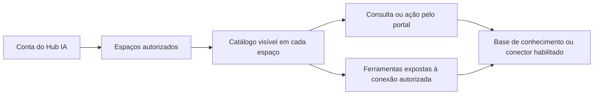

# Hub IA — Central de documentação

O Hub IA é o portal da Peso Exato para distribuir agentes, bases de conhecimento e serviços autorizados a usuários de diferentes instituições. Cada conta tem um espaço pessoal. O acesso aos espaços institucionais e aos agentes é definido pelos vínculos, pelo catálogo e pelas permissões de cada conexão.

A análise inicial partiu da revisão `9e69bbd733653589851c54866f2fad2c14915bd0`. As notas de integração e permissões também descrevem a unificação do MCP no checkout local. A nota de operação registra os testes e o alcance de cada validação.

## Mapa de navegação

- [[docs/AI_CONTEXT_GUIDE|Guia de contexto para IAs]] para localizar o ponto de entrada de uma mudança e escolher as verificações.
- [[docs/Web/Arquitetura_e_Execucao|Arquitetura e execução]] para entender o portal, o catálogo, a execução e o histórico dos agentes.
- [[docs/Regras de Negocio/Identidade_e_Permissoes|Identidade e permissões]] para investigar contas, instituições, ACLs, catálogo efetivo e RLS.
- [[docs/Regras de Negocio/IAves|IAves]] para configurar o modelo e entender a consulta local, a memória da conta e os dados do AviHUB.
- [[docs/Regras de Negocio/AviHUB_Relatorios_Peso_Aves|Relatórios de Peso Aves]] para gerar, acompanhar e receber arquivos do AviHUB.
- [[docs/Regras de Negocio/AviHUB_Notificacoes|Notificações do AviHUB]] para listar, buscar e consultar avisos da conta vinculada.
- [[docs/Regras de Negocio/Jornada_Clientes|Jornada dos clientes]] para acompanhar a primeira consulta, as ações do painel e os resumos e alertas.
- [[docs/API_Middleware/Integracoes_e_MCP|Integrações e MCP]] para conferir descoberta, consentimento, ferramentas e conectores externos.
- [[docs/Infra/Operacao_e_Testes|Operação e testes]] para preparar o banco local, aplicar migrações, validar e interpretar o deploy.

## Fluxo do usuário

Na interface, **Meus espaços** mostra os espaços visíveis e **Guia dos meus espaços** reúne papéis e agentes quando habilitado para a conta. O modelo de IA é configurado por espaço. As conexões externas usam os acessos concedidos pelo usuário e as permissões atuais do Hub. [Rotas do portal](https://github.com/reinaldopesoexato/hubia/blob/9e69bbd733653589851c54866f2fad2c14915bd0/apps/portal/views.py) · [Catálogo e guia](https://github.com/reinaldopesoexato/hubia/blob/9e69bbd733653589851c54866f2fad2c14915bd0/apps/portal/dashboard.py) · [Autorização da conexão](https://github.com/reinaldopesoexato/hubia/blob/9e69bbd733653589851c54866f2fad2c14915bd0/apps/portal/bridge/access.py).

## Referências do projeto

- [[README|README e comandos do repositório]]
- [[docs/adr/0001-identidade-e-tenancy|ADR de identidade e isolamento]]
- [[docs/security/tenancy|Fronteiras de confiança do banco]]
- [[docs/integracoes|Inventário inicial de integrações]]

O ADR e as notas iniciais registram decisões e hipóteses da primeira entrega. Consulte as notas acima e confirme o comportamento na revisão de código usada em cada tarefa.
