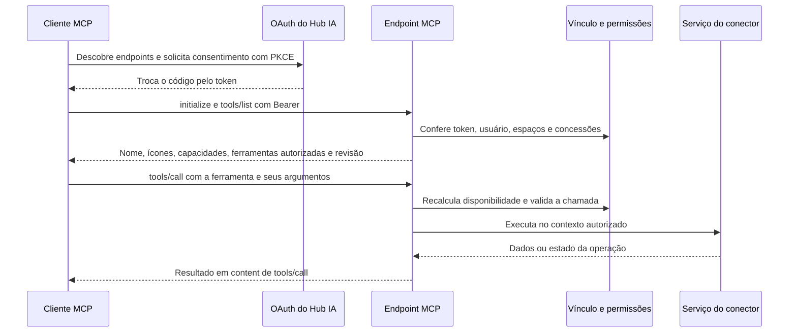
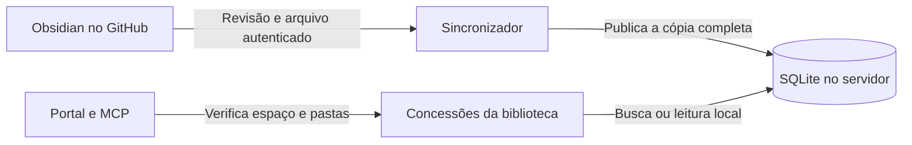

# Integrações e MCP do Hub IA

O módulo Django `apps/portal/bridge/` reúne as ferramentas autorizadas em um conector MCP, recebe e envia mensagens A2A e liga o portal a serviços externos. O catálogo e as ações dependem da conexão autenticada, dos espaços visíveis e das permissões de cada conector. Consulte [[docs/00-HubIA-Home|central do Hub IA]], [[docs/Web/Arquitetura_e_Execucao|arquitetura e execução]] e [[docs/Regras de Negocio/Identidade_e_Permissoes|identidade e permissões]].

## Conexões e autorização

Use o nome **HUB IA**, a URL `https://hubia.psxt.io/conta/mcp` e OAuth em cada cliente. No ChatGPT web, crie um aplicativo MCP personalizado com as permissões de desenvolvedor do workspace. No Claude, adicione um conector remoto em **Customize → Connectors** e escolha registro automático. No Gemini, use uma edição que aceite servidor MCP remoto, como o Gemini Enterprise. Os nomes dos menus e os recursos disponíveis variam por edição e pelas permissões do administrador. [ChatGPT](https://help.openai.com/en/articles/12584461-developer-mode-and-full-mcp-connectors-in-chatgpt-beta) · [Claude](https://support.claude.com/en/articles/11175166-get-started-with-custom-connectors-using-remote-mcp) · [Gemini Enterprise](https://docs.cloud.google.com/gemini/enterprise/docs/connectors/custom-mcp-server/set-up-custom-mcp-server).

Em **Minhas integrações**, o cadastro manual de MCP gera um cliente OAuth confidencial com a URI HTTPS de retorno fornecida pelo cliente. Use esse fluxo quando a edição do cliente exigir credenciais próprias. O registro dinâmico limita as URIs de retorno aos padrões reconhecidos pelo Hub IA. O consentimento cria o vínculo `Link` entre o proprietário, o cliente e o espaço de origem. [OAuth](https://github.com/reinaldopesoexato/hubia/blob/main/apps/portal/bridge/oauth.py) · [Cadastro manual](https://github.com/reinaldopesoexato/hubia/blob/main/apps/portal/bridge/portal.py).

Conexões unificadas incluem o espaço pessoal e os espaços institucionais aos quais a pessoa tem acesso, conforme o consentimento. Em **Espaços das minhas IAs**, `WorkspaceSelection` usa `null` para todos os espaços da conexão, uma lista de IDs para limitar o acesso e `[]` para pausar. As ACLs dos espaços e as concessões dos conectores são reavaliadas a cada acesso. As conexões antigas preservam seu escopo institucional e suas configurações. [Seleção de espaços](https://github.com/reinaldopesoexato/hubia/blob/main/apps/portal/bridge/workspaces.py).

| Recurso | Endpoint e contrato |
| --- | --- |
| MCP do HUB IA | `/conta/mcp`, com metadados em `/.well-known/oauth-protected-resource/conta/mcp` e `/.well-known/oauth-authorization-server`. As rotas de autorização, token e cadastro ficam sob `/conta/oauth/`. |
| MCP legado de e-mail | `/conta/mcp/email`, mantido para compatibilidade. O emissor legado fica em `/conta/email`. O portal orienta novas conexões pelo endereço unificado. |
| A2A de entrada | Agent Card público em `/.well-known/agent-card.json`. A rota `/conta/a2a` exige a chave Bearer de um vínculo A2A. |
| A2A de saída | Vínculo `peer` com URL HTTPS de Agent Card e credencial opcional. O Bearer fica restrito à origem do card e a configuração fica cifrada. |

O MCP usa código de autorização com PKCE S256 e envia o token no cabeçalho `Authorization`. O escopo `hub.read` é necessário para autenticar. `hub.reply` e `hub.notify` dependem também de um vínculo gravável e de papel de escrita na instituição da operação. `hub.mail.send` exige papel de escrita e autorização de envio na caixa vinculada. `offline_access` é o escopo para renovação. A revogação elimina o vínculo e a aplicação OAuth manual ou os tokens e grants daquele usuário para uma aplicação dinâmica.

Fontes do contrato de acesso. [Rotas Django](https://github.com/reinaldopesoexato/hubia/blob/main/apps/portal/views.py) · [Contexto da conexão](https://github.com/reinaldopesoexato/hubia/blob/main/apps/portal/bridge/access.py).

### Nome e ícone nos clientes

No `initialize`, `serverInfo` publica o identificador `hub-ia`, o título **HUB IA**, o site e as duas versões do ícone oficial. As ferramentas MCP usam os mesmos ícones. O cabeçalho HTTP `Link` anuncia as imagens de 64 e 512 pixels no servidor MCP e nos metadados OAuth. O recurso OAuth informa o nome e a página pública, que anuncia as mesmas imagens e o favicon. [Metadados do Hub IA](https://github.com/reinaldopesoexato/hubia/blob/main/apps/portal/bridge/access.py) · [Especificação MCP de ícones](https://modelcontextprotocol.io/specification/2025-11-25/basic#icons) · [RFC 9728, metadados de recursos OAuth](https://www.rfc-editor.org/rfc/rfc9728.html#section-2).

Cada cliente decide onde e quando renderizar esses metadados. O catálogo público do ChatGPT recebe o logo como parte da publicação do app. O Claude pode usar a identidade do catálogo em conectores cujo domínio corresponda a uma entrada publicada. A configuração de servidor MCP do Gemini Enterprise documenta URL e autenticação. A validação visual depende da interface e do tipo de instalação usado em cada produto. [Publicação no ChatGPT](https://developers.openai.com/plugins/deploy/submission) · [Conectores personalizados no Claude](https://support.claude.com/en/articles/11175166-get-started-with-custom-connectors-using-remote-mcp) · [Configuração no Gemini Enterprise](https://docs.cloud.google.com/gemini/enterprise/docs/connectors/custom-mcp-server/set-up-custom-mcp-server).

## Descoberta e chamada de ferramentas

- O servidor usa JSON-RPC 2.0 e reconhece as versões MCP `2025-11-25`, `2025-06-18` e `2025-03-26`. O resultado de `tools/call` traz o JSON serializado em `result.content[0].text`.
- `tools/list` é o catálogo efetivo do token. A ferramenta `list_agents` indica as entradas de agentes em `_meta["io.psxt.hubia/agents"]` e devolve o tipo e a URL da página autenticada de cada agente. Para abrir um portal externo, siga o link na página do agente. A revisão do catálogo de ferramentas vem em `result._meta["io.psxt.hubia/revision"]`. Um agente visível no portal pode ter concessões insuficientes para publicar suas ferramentas nessa conexão.
- Nas conexões unificadas, `consultar_agente` publica o executor de agentes de conhecimento e de consulta a APIs configuradas em espaços com papel diferente de leitor. Envie `agent_id`, `pergunta` e um `request_id` UUID único para a consulta. O retorno traz `resposta`. O executor compartilhado processa a consulta sem incorporar o histórico de conversa do agente no portal.
- `listar_espacos` devolve os IDs autorizados. Na consulta a agentes, notas e destinos e no envio de avisos, `space_id` é obrigatório se houver vários espaços. Para AviHUB, a omissão permite que o HUB selecione um espaço autorizado com o agente ativo, dando preferência ao espaço de origem.
- `initialize` anuncia `tools.listChanged`. Um GET autenticado com `Accept: text/event-stream` reavalia o catálogo a cada 15 segundos e encerra o fluxo quando perde a autorização. Um POST de `ping` ou `tools/call` que aceite SSE também pode carregar `notifications/tools/list_changed` antes do resultado. Após o aviso, chame `tools/list` novamente. Para clientes que só aceitam JSON, use `tools/list` nas verificações de catálogo.

Na instalação do **HUB IA - Peso Exato** como plugin de desenvolvimento no ChatGPT Work, abra **Plugins → HUB IA - Peso Exato → Settings → Refresh tools** após publicar mudanças de ferramentas. Confirme o catálogo em **View details → Apps** e teste em uma conversa Work nova com o plugin selecionado. Em 26/11/2026, esse fluxo passou de 27 para 32 ações de leitura e exibiu as três operações de notificações do AviHUB e as ações de relatórios de Peso Aves. [Atualização de ferramentas no ChatGPT](https://developers.openai.com/plugins/deploy/connect-chatgpt#refresh-metadata).
- Em **Espaços das minhas IAs → Diagnóstico MCP**, o proprietário vê a data e os nomes das ferramentas que o HUB retornou no último `tools/list` da conexão. O registro persiste na renovação do token e guarda somente data e identificadores das ferramentas. Uma consulta anterior à migração `0029` pode exibir somente a data enquanto sua observação estiver disponível.
- O diagnóstico também mostra as ferramentas disponíveis com a autorização OAuth válida mais recente, a seleção de espaços e as concessões atuais. As orientações indicam quando reativar espaços, reconectar a IA, adicionar um escopo, liberar a biblioteca, vincular a caixa de e-mail ou a conta AviHUB, sincronizar a cópia local do IAves ou atualizar o catálogo no cliente. O cálculo usa o banco e as cópias locais. A lista anterior descreve a resposta do HUB ao cliente. A chamada direta revalida a disponibilidade da ferramenta.

Fontes do catálogo. [Implementação MCP](https://github.com/reinaldopesoexato/hubia/blob/main/apps/portal/bridge/mcp.py), [registro, revisão e SSE](https://github.com/reinaldopesoexato/hubia/blob/main/apps/portal/bridge/discovery.py) e [diagnóstico local](https://github.com/reinaldopesoexato/hubia/blob/main/apps/portal/bridge/catalog_diagnostics.py).

## Tarefas, webhooks e A2A

- No MCP, `list_tasks` lista pendências do vínculo, `fetch_task` lê uma tarefa e marca avisos de catálogo como lidos, e `reply_task` registra a resposta quando autorizado. As tarefas e os avisos associados ao vínculo usam seu espaço de origem. O cadastro de tarefas no portal usa `request_id` único por vínculo para deduplicar.
- A assinatura de `hub.task.created` usa desafio de verificação do callback e vence em um dia. O webhook assinado divulga o `task_id`. O cliente busca o conteúdo com `fetch_task`. O worker revalida o vínculo antes de entregar, repete falhas temporárias com o mesmo ID de evento e registra o estado. Clientes sem webhook podem consultar pendências.
- Avisos de catálogo são opcionais no espaço e dependem da disponibilidade do agente e da permissão do destinatário. Em MCP são tarefas do tipo `hub.agent.available`. Em A2A aparecem na consulta textual `listar avisos` ou, quando o vínculo é de saída, vão como mensagem ao agente remoto. O worker processa entregas de webhook e avisos A2A de saída.
- A entrada A2A aceita `SendMessage` textual em JSON-RPC A2A 1.0. A conexão consulta o catálogo e os avisos do seu espaço, além do guia quando habilitado. A busca textual nas bases locais do tipo `knowledge` exige papel diferente de `viewer`.
- A saída A2A descobre no card uma interface JSON-RPC 1.0 da mesma origem e usa `SendMessage`. Se o agente devolver uma tarefa assíncrona, o portal disponibiliza consulta de andamento via `GetTask`. A resposta ou o ID remoto fica no registro da tarefa.

Fontes das rotas e filas. [A2A](https://github.com/reinaldopesoexato/hubia/blob/9e69bbd733653589851c54866f2fad2c14915bd0/apps/portal/bridge/a2a.py), [eventos MCP](https://github.com/reinaldopesoexato/hubia/blob/9e69bbd733653589851c54866f2fad2c14915bd0/apps/portal/bridge/events.py), [avisos do catálogo](https://github.com/reinaldopesoexato/hubia/blob/9e69bbd733653589851c54866f2fad2c14915bd0/apps/portal/bridge/catalog_alerts.py) e [worker](https://github.com/reinaldopesoexato/hubia/blob/9e69bbd733653589851c54866f2fad2c14915bd0/apps/portal/bridge/worker.py).

## Conectores e concessões

### **IA**ves

`consultar_iaves` fica disponível nos espaços autorizados com o agente ativo. As instruções do `initialize`, o catálogo e o guia orientam as IAs a usar essa ferramenta primeiro em dúvidas de qualquer etapa da cadeia avícola. O retorno pode trazer uma resposta do modelo configurado, trechos da biblioteca local ou uma pergunta para obter contexto adicional. Use as ferramentas do AviHUB para dados e operações da conta autorizada. `memorizar_iaves` e a leitura de memória dependem do escopo `hub.iaves.memory`. [[docs/Regras de Negocio/IAves|Operação do IAves]].

Use “Fonte base de conhecimento **IA**ves” para citar a biblioteca na resposta padrão. Em saídas de texto simples, use `IAves`. Se o usuário pedir detalhes de uma consulta anterior, envie à ferramenta `consultar_iaves` o valor de `referencia_fontes` recebido naquela consulta. Catálogos antigos podem passar esse valor em `pergunta`, depois do prefixo `Detalhar fontes: `. O Hub verifica a conexão OAuth e o espaço autorizado antes de devolver os detalhes. Mostre só o nome de cada arquivo e a revisão. A referência opaca vale por sete dias e fica no cliente MCP, fora da resposta ao usuário. [Ferramenta MCP](https://github.com/reinaldopesoexato/hubia/blob/main/apps/portal/bridge/mcp.py) · [Consulta do IAves](https://github.com/reinaldopesoexato/hubia/blob/main/apps/portal/bridge/iaves.py).

### GitHub e biblioteca de notas

A instituição registra e instala uma GitHub App privada com repositórios selecionados e `Contents: Read-only`. O serviço `library-sync` usa um token temporário limitado ao repositório para sincronizar a revisão da branch padrão. A revisão publicada fica em uma cópia SQLite persistente no servidor. O portal e o MCP consultam essa cópia local e verificam a concessão do espaço a cada chamada. Cada espaço precisa de agente `library` ativo e pastas concedidas. Uma concessão com `/` inclui notas da raiz e de subpastas. O campo de pastas vazio revoga a leitura. A biblioteca considera arquivos Markdown regulares e caminhos visíveis sob a concessão.

`buscar_notas` recebe `consulta`, `pagina` e `revisao`. Continue com `proxima_pagina` enquanto houver valor. `ler_nota` recebe o `caminho` exato retornado e, para ler o restante, use `proximo_inicio` no argumento `inicio`. Preserve a `revisao` nas chamadas de continuação. Se a revisão local avançar entre chamadas, reinicie a consulta. A leitura devolve um link `fonte` fixado no commit da cópia consultada.

O painel GitHub mostra a revisão e a data da cópia local. Falhas temporárias preservam a última cópia íntegra. O sincronizador remove a cópia ao detectar revogação da fonte. As permissões de pasta e espaço são consultadas no Hub a cada chamada.

Fontes da biblioteca. [Administração do conector](https://github.com/reinaldopesoexato/hubia/blob/main/apps/portal/bridge/github.py) · [Sincronização](https://github.com/reinaldopesoexato/hubia/blob/main/apps/portal/bridge/library_sync.py) · [Busca e leitura de notas](https://github.com/reinaldopesoexato/hubia/blob/main/apps/portal/bridge/library.py).

### E-mail da pessoa e e-mail da plataforma

O e-mail conectado à IA exige elegibilidade ao e-mail interno da instituição Peso Exato, conector habilitado e caixa do próprio usuário. Leitura e envio têm concessões por vínculo. `listar_emails_novos`, `buscar_emails` e `ler_email` consultam a INBOX via IMAP usando marcadores e IDs retornados pela ferramenta. `enviar_email` recebe um destinatário, assunto, mensagem em texto simples e `request_id` UUID. A caixa vinculada é o remetente. A mesma combinação de campos e UUID consulta a tentativa registrada. `aceito_pelo_smtp` registra o aceite do provedor. Estados como `incerto` ou `registrado` exigem conferência antes de um novo envio.

O mesmo conector MCP publica as ferramentas de caixa e assinatura para conexões com as concessões correspondentes. As conexões legadas de e-mail mantêm seu catálogo de caixa e assinatura. O e-mail da plataforma tem configuração SMTP própria para os fluxos de ativação e redefinição de senha do Hub IA.

Fontes do e-mail. [Elegibilidade](https://github.com/reinaldopesoexato/hubia/blob/9e69bbd733653589851c54866f2fad2c14915bd0/apps/portal/bridge/mail_access.py), [caixa e envio](https://github.com/reinaldopesoexato/hubia/blob/9e69bbd733653589851c54866f2fad2c14915bd0/apps/portal/bridge/mailbox_service.py) e [e-mail da plataforma](https://github.com/reinaldopesoexato/hubia/blob/9e69bbd733653589851c54866f2fad2c14915bd0/apps/portal/bridge/platform_email.py).

### Notificações por WhatsApp

O agente `notifications` usa um canal configurado por espaço e agente. O adaptador registrado em `CHANNELS` envia texto via LeadFinder. `descrever_envio` consulta o contrato. `listar_destinos` retorna atalhos autorizados. `enviar_aviso` exige `agent_id`, `canal`, `mensagem`, `request_id` UUID e exatamente um entre `destinatario` e `destino`. Um endereço direto equivalente a um destino restrito também passa pela regra de visibilidade.

O envio registra a reserva antes do POST e usa o mesmo identificador para devolver o estado da mesma tentativa. Respostas HTTP de sucesso registram o retorno do provedor. A confirmação de recebimento fica com o canal ou destinatário. Uma falha de resultado incerto deve ser conferida antes de iniciar outro envio.

Fontes do canal. [Regras de envio e destinos](https://github.com/reinaldopesoexato/hubia/blob/9e69bbd733653589851c54866f2fad2c14915bd0/apps/portal/bridge/notifications.py) e [transporte LeadFinder](https://github.com/reinaldopesoexato/hubia/blob/9e69bbd733653589851c54866f2fad2c14915bd0/apps/portal/notification_channels.py).

### AviHUB

O agente ativo no espaço expõe as operações AviHUB via MCP. Os vínculos da conta externa pertencem ao usuário dentro da instituição, com cookies de sessão cifrados. Login e eventual verificação em duas etapas ocorrem no portal do Hub IA. O cliente orienta o usuário com `mensagem` e `url_vinculo` quando recebe `vinculo_necessario`.

Com várias contas, use `listar_contas_avihub` e mantenha a conta escolhida no argumento `conta`. Verifique a unidade via `listar_unidades_avihub`. `selecionar_unidade_avihub` altera a unidade ativa também no painel AviHUB e depende da escolha do usuário. O conector confere a unidade ativa e o módulo nas páginas nativas em cada relatório. As consultas incluem equipamentos, pesagens, sensores, ração, silos, SAC e cadastros. `solicitar_redefinicao_senha_avihub` usa o fluxo nativo de recuperação, funciona antes do vínculo e devolve uma mensagem condicional.

Na Central de Notificações, `listar_notificacoes_avihub`, `buscar_notificacoes_avihub` e `consultar_notificacao_avihub` usam a sessão da conta vinculada, com a permissão de leitura do espaço. A busca usa a central nativa e o detalhe preserva os filtros e a página de origem. `listar_contas_avihub` também devolve o link do painel protegido. [[docs/Regras de Negocio/AviHUB_Notificacoes|Notificações do AviHUB]].

Na aba Peso Aves, `opcoes_relatorio_peso_aves` obtém filtros, formatos e canais disponíveis, `gerar_relatorio_peso_aves` registra a solicitação e `consultar_relatorio_peso_aves` acompanha a geração e a entrega. Após confirmar a notificação, o Hub IA disponibiliza o arquivo do AviHUB ou o PDF impresso da prévia oficial. O usuário escolhe entre painel, e-mail disponível e destinos de WhatsApp autorizados. O MCP pode retornar o arquivo como recurso em clientes compatíveis, além do link autenticado. [[docs/Regras de Negocio/AviHUB_Relatorios_Peso_Aves|Relatórios de Peso Aves]].

Fontes da integração. [Sessões e vínculos](https://github.com/reinaldopesoexato/hubia/blob/9e69bbd733653589851c54866f2fad2c14915bd0/apps/portal/bridge/avihub.py), [contrato de relatórios](https://github.com/reinaldopesoexato/hubia/blob/9e69bbd733653589851c54866f2fad2c14915bd0/apps/portal/bridge/avihub_api.py) e [cliente do painel](https://github.com/reinaldopesoexato/hubia/blob/9e69bbd733653589851c54866f2fad2c14915bd0/apps/portal/bridge/avihub_client.py).

## Evidência e validação

Esta nota acompanha a mudança de MCP unificado no checkout local a partir de `9e69bbd`. O smoke completo passou em PostgreSQL 16.16 descartável e verificou OAuth, seleção de espaços, descoberta MCP, metadados do ícone, catálogo, tarefas e avisos. Os conectores externos usaram serviços simulados. A publicação, a exibição do ícone pelos clientes e as entregas externas ficam pendentes de verificação em ambiente autorizado. Para seguir a suíte, consulte [[docs/Infra/Operacao_e_Testes|operação e testes]]. O [[docs/integracoes|inventário inicial de integrações]] conserva as evidências iniciais e os pontos de investigação sobre WhatsIA e monitor de GitHub Actions.

Fontes dos testes. [Smoke do portal](https://github.com/reinaldopesoexato/hubia/blob/9e69bbd733653589851c54866f2fad2c14915bd0/apps/portal/smoke.py), [smoke da ponte](https://github.com/reinaldopesoexato/hubia/blob/9e69bbd733653589851c54866f2fad2c14915bd0/apps/portal/bridge/smoke.py) e [testes do portal](https://github.com/reinaldopesoexato/hubia/tree/9e69bbd733653589851c54866f2fad2c14915bd0/tests/portal).
