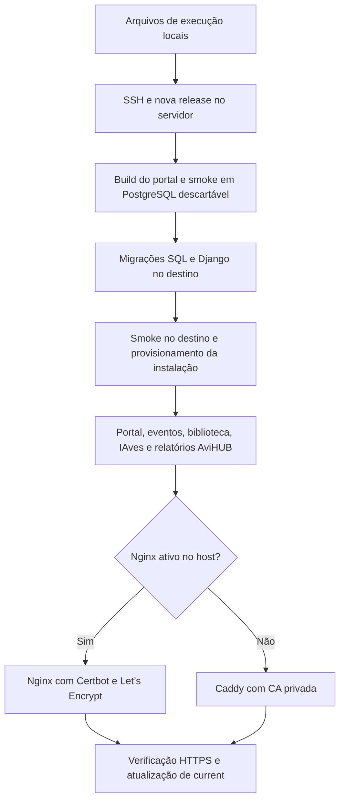

# Operação e testes do Hub IA

Volte à [[docs/00-HubIA-Home|central do Hub IA]] ou consulte [[docs/Web/Arquitetura_e_Execucao|arquitetura e execução]], [[docs/Regras de Negocio/Identidade_e_Permissoes|identidade e permissões]] e [[docs/API_Middleware/Integracoes_e_MCP|integrações e MCP]].

## Ambiente de desenvolvimento

O Compose da raiz inicia apenas o PostgreSQL 16.16, publicado em `127.0.0.1` na porta `54329` por padrão. `POSTGRES_PORT` permite escolher outra porta de desenvolvimento. Configure `POSTGRES_PASSWORD` em um `.env` local usando `.env.example` como referência. Use um cluster dedicado ao Hub IA, pois os papéis PostgreSQL têm escopo de cluster. [Compose local](https://github.com/reinaldopesoexato/hubia/blob/9e69bbd733653589851c54866f2fad2c14915bd0/compose.yaml) · [Modelo de configuração](https://github.com/reinaldopesoexato/hubia/blob/9e69bbd733653589851c54866f2fad2c14915bd0/.env.example)

Da raiz do repositório, inicie o banco de desenvolvimento e aplique as migrações SQL. O `docker compose cp` preserva os caminhos dos `\ir` usados por `psql`.

```sh
docker compose up -d --wait postgres
docker compose exec -T postgres mkdir -p /tmp/hubia-migrations
docker compose cp packages/database/. postgres:/tmp/hubia-migrations/
docker compose exec -T postgres psql -X -U hub_migrator -d hubia -f /tmp/hubia-migrations/migrate.psql
```

O portal usa Python 3.13 na imagem, Django 5.2, Psycopg e Uvicorn com dois workers. A imagem define `DJANGO_SETTINGS_MODULE=settings` e executa como UID/GID 65534. O HTML público é estático em `apps/web/public/`. O processo Django espera o banco `hubia` no host `postgres`, com `PGPASSWORD` e `PORTAL_SESSION_SECRET`. O papel é `hub_portal` por padrão. Para um teste no navegador, o `ALLOWED_HOSTS` usa `hubia.psxt.io`, e as sessões e o CSRF dependem de HTTPS. O host e a porta do PostgreSQL publicados no Mac atendem clientes locais como `psql`. [Dockerfile](https://github.com/reinaldopesoexato/hubia/blob/9e69bbd733653589851c54866f2fad2c14915bd0/apps/portal/Dockerfile) · [Dependências](https://github.com/reinaldopesoexato/hubia/blob/9e69bbd733653589851c54866f2fad2c14915bd0/apps/portal/requirements.txt) · [Configuração Django](https://github.com/reinaldopesoexato/hubia/blob/9e69bbd733653589851c54866f2fad2c14915bd0/apps/portal/settings.py)

## Migrações e credenciais

| Etapa | Papel | Escopo |
| --- | --- | --- |
| `psql -f migrate.psql` | `hub_migrator` | Cria esquemas, papéis, funções, tabelas e políticas SQL. O script usa uma transação, bloqueio consultivo transacional e registro em `hub_migrations.applied` para aplicar apenas versões pendentes. A versão `014` provisiona o IAves e a versão `015` disponibiliza a coorte de novos clientes ao administrador geral. |
| Definição da senha do papel do portal | `hub_migrator` | Configura a senha PostgreSQL de `hub_portal` antes do `migrate` Django. |
| `python -m django migrate --noinput` | `hub_portal` | Aplica autenticação, sessões, OAuth e os modelos de `bridge` no `search_path` `hub_accounts,pg_catalog`. A migração `0025_link_all_tenants` registra o escopo dos vínculos MCP unificados. As versões `0026` a `0029` criam a configuração e memória do IAves, avaliações, assinaturas e registro de catálogo MCP. A `0030_avihub_reports` cria a fila e o histórico de solicitações da aba Peso Aves. |

A migração `0031_avihub_report_confirmation` adiciona o acompanhamento da notificação nativa, os metadados do arquivo e o campo cifrado para os PDFs impressos no Hub IA. Os relatórios anteriores continuam acessíveis pelo formato registrado. [[docs/Regras de Negocio/AviHUB_Relatorios_Peso_Aves|Relatórios de Peso Aves]].

Anote a trilha afetada em mudanças de banco. Novos arquivos SQL precisam ser referenciados em `migrate.psql`. O smoke em Docker reproduz o registro legado `0016_avihub_unit_keys` e a antiga coluna obrigatória antes de migrar ao estado atual. `0018_avihub_legacy_unit_keys` preserva os dados legados enquanto permite gravar novas sessões. [Executor SQL](https://github.com/reinaldopesoexato/hubia/blob/9e69bbd733653589851c54866f2fad2c14915bd0/packages/database/migrate.psql) · [Migrações Django de bridge](https://github.com/reinaldopesoexato/hubia/tree/9e69bbd733653589851c54866f2fad2c14915bd0/apps/portal/bridge/migrations) · [Atualização de esquema AviHUB](https://github.com/reinaldopesoexato/hubia/blob/9e69bbd733653589851c54866f2fad2c14915bd0/apps/portal/bridge/migrations/0018_avihub_legacy_unit_keys.py)

Em produção, o `deploy.env` persistente guarda `POSTGRES_PASSWORD`, `PORTAL_DB_PASSWORD`, `PORTAL_SESSION_SECRET` e, quando configurados, `GOOGLE_CLIENT_ID` e `GOOGLE_CLIENT_SECRET`. O segredo do portal sustenta as sessões e participa da derivação da chave Fernet usada para ler credenciais gravadas. Preserve-o junto com os backups protegidos do banco. O cadastro de conectores usa `connectors/connectors.json` no diretório persistente do servidor, montado no portal como `/run/hubia/connectors.json` somente para leitura. O arquivo deve ser legível pelo grupo 65534. [Instalador remoto](https://github.com/reinaldopesoexato/hubia/blob/9e69bbd733653589851c54866f2fad2c14915bd0/scripts/apply-release.sh) · [Compose de produção](https://github.com/reinaldopesoexato/hubia/blob/9e69bbd733653589851c54866f2fad2c14915bd0/deploy/compose.production.yaml) · [Derivação Fernet](https://github.com/reinaldopesoexato/hubia/blob/9e69bbd733653589851c54866f2fad2c14915bd0/apps/portal/model_provider.py)

## Testes locais e evidências

| Verificação | Entrada | Evidência obtida no teste |
| --- | --- | --- |
| Unitários Python | `python -m unittest discover -s tests/portal -v` | Exercita os contratos de agente/modelo, o cliente e consultas do AviHUB, o protocolo de e-mail e notificações LeadFinder com mocks e dados de teste. Usa as dependências Python do portal. |
| Isolamento SQL | `docker compose exec -T postgres psql -X -U hub_migrator -d hubia < tests/integration/tenancy.psql` | Rodar sobre banco local recém-migrado. Exercita provisionamento, papéis, ACL, suspensão, desativação e descarte do contexto transacional ao reutilizar a conexão. Os dados de teste são revertidos. |
| Smoke do portal com banco descartável | `bash scripts/test-portal.sh postgres:16.16-bookworm hubia-local-portal`, após `docker build -t hubia-local-portal apps/portal` | Cria PostgreSQL temporário em `tmpfs`, em rede Docker interna e sem porta publicada. Aplica SQL e Django, simula esquema legado do AviHUB e executa `smoke.py`. O banco sem proprietário permite exercitar também o bootstrap administrativo. |
| Smoke no banco de destino | Invocado por `scripts/apply-release.sh` após `migrate` | Usa Django Test Client, contas temporárias e rollback. Com proprietário existente, pula o bloco de bootstrap administrativo. O teste no banco descartável é pré-requisito do instalador para chegar à migração no destino. |

Em `smoke.py`, os casos de login, CSRF, portal e permissões usam PostgreSQL real. Os submódulos de smoke usam fixtures e mocks para cobrir integrações, incluindo modelo de IA, e-mail, GitHub, AviHUB e notificações. O comando `scripts/test-portal.sh` roda o smoke Django. Execute `tests/integration/tenancy.psql` separadamente quando a mudança afetar políticas SQL. [Testes unitários](https://github.com/reinaldopesoexato/hubia/tree/9e69bbd733653589851c54866f2fad2c14915bd0/tests/portal) · [Suíte SQL](https://github.com/reinaldopesoexato/hubia/blob/9e69bbd733653589851c54866f2fad2c14915bd0/tests/integration/tenancy.psql) · [Preparação do smoke](https://github.com/reinaldopesoexato/hubia/blob/9e69bbd733653589851c54866f2fad2c14915bd0/scripts/test-portal.sh) · [Smoke Django](https://github.com/reinaldopesoexato/hubia/blob/9e69bbd733653589851c54866f2fad2c14915bd0/apps/portal/smoke.py)

Na validação do MCP unificado, passaram 39 testes unitários em Python 3.11 e o smoke completo do portal em Docker com Python 3.13 e PostgreSQL 16.16 descartável. O smoke aplicou as migrações SQL e Django e verificou OAuth com PKCE, catálogo e seleção entre instituições, consulta a agentes, revogação e consentimento de e-mail numa conexão com origem pessoal. As integrações externas usaram serviços simulados. A exibição do ícone nos clientes reais fica pendente de validação.

O smoke da jornada do IAves exercitou cadastro padrão, consulta local com revisão, memória privada, avaliação e indicadores administrativos, diagnóstico do catálogo MCP e acompanhamentos por unidade e lote. As consultas do AviHUB e o envio SMTP usaram fixtures. O teste de cliente no ambiente publicado está descrito em [[docs/Regras de Negocio/Jornada_Clientes|Jornada dos clientes]].

## Publicação e acompanhamento

`Deploy-HUB-IA.command` chama `scripts/deploy.sh`, que empacota os arquivos de execução do diretório de trabalho e envia por SSH para `root@hubia.psxt.io`. A porta pode vir da configuração SSH ou de `HUBIA_SSH_PORT`. O servidor extrai o pacote em `~/.local/share/hubia/releases/`. O instalador usa `flock` para serializar a publicação. O PostgreSQL fica na rede privada do projeto Compose `hubia-prod` e o portal usa `127.0.0.1:18873`. Após as migrações, o instalador inicia `events`, `library-sync`, `iaves-alerts` e `avihub-reports` com a imagem `hubia-prod-portal`. O serviço `events` processa notificações, recuperação de senha e ativação de contas. O serviço `library-sync` mantém a cópia da biblioteca. `iaves-alerts` verifica os acompanhamentos ativos do IAves e `avihub-reports` processa geração e entrega de relatórios Peso Aves. [Envio do pacote](https://github.com/reinaldopesoexato/hubia/blob/main/scripts/deploy.sh) · [Instalador remoto](https://github.com/reinaldopesoexato/hubia/blob/main/scripts/apply-release.sh) · [Processador de relatórios](https://github.com/reinaldopesoexato/hubia/blob/main/apps/portal/bridge/avihub_report_worker.py)

`avihub-pdf` tem imagem própria e atende somente o worker `avihub-reports` na rede interna de impressão. O contêiner não recebe as credenciais do portal e não publica porta. A verificação `/health` confirma o serviço de impressão, e os testes de geração usam uma prévia HTML fictícia e verificam o binário PDF retornado. [Serviços de produção](https://github.com/reinaldopesoexato/hubia/blob/main/deploy/compose.production.yaml).



Com Nginx ativo, o instalador administra o virtual host do Hub IA, usa a porta TCP 80 para o desafio HTTP-01 e valida o HTTPS, a página inicial, o formulário de login e os arquivos estáticos. Em hosts sem Nginx ativo, o Caddy publica a porta 443 e a verificação usa a CA privada. `/health/edge` é respondido pelo proxy. A saúde do contêiner `portal` verifica separadamente `/conta/entrar/`. Confirme a revisão ativa e o fluxo afetado antes de atribuir o resultado à publicação. Se houver falha após migrar, o link `current` pode continuar apontando para a release anterior enquanto o banco já recebeu as migrações. [Nginx](https://github.com/reinaldopesoexato/hubia/blob/9e69bbd733653589851c54866f2fad2c14915bd0/scripts/install-nginx.sh) · [Caddy](https://github.com/reinaldopesoexato/hubia/blob/9e69bbd733653589851c54866f2fad2c14915bd0/deploy/Caddyfile) · [Verificação do contêiner](https://github.com/reinaldopesoexato/hubia/blob/9e69bbd733653589851c54866f2fad2c14915bd0/deploy/compose.production.yaml)

Na publicação de 26/11/2026, o instalador aplicou as migrações SQL e Django, concluiu o smoke no destino e iniciou o portal, `events`, `library-sync` e `iaves-alerts`. A verificação externa retornou `ok` no proxy e confirmou o escopo `hub.iaves.memory` no MCP. A consulta com uma conta de cliente e a leitura da primeira cópia sincronizada do repositório privado ainda precisam ser verificadas. [Saúde do proxy](https://hubia.psxt.io/health/edge) · [Metadados públicos do MCP](https://hubia.psxt.io/.well-known/oauth-protected-resource/conta/mcp)

### Cópia local da biblioteca

O serviço `library-sync` inicia a sincronização com `python -m bridge.library_sync` e repete a verificação a cada 300 segundos por padrão. Ajuste `HUBIA_KNOWLEDGE_SYNC_INTERVAL` em `deploy.env` e reaplique o deploy para alterar a cadência. O volume privado `library-data` guarda as cópias SQLite em `/var/lib/hubia/knowledge`. O sincronizador grava como UID 65534 e o portal monta o volume somente para leitura. A cópia persiste entre releases e contém conteúdo institucional. Restrinja as cópias de segurança desse volume às mesmas pessoas autorizadas a operar o serviço. [Compose de produção](https://github.com/reinaldopesoexato/hubia/blob/main/deploy/compose.production.yaml) · [Sincronizador](https://github.com/reinaldopesoexato/hubia/blob/main/apps/portal/bridge/library_sync.py)

Após configurar uma biblioteca pela primeira vez, confirme a sincronização pelos logs de `library-sync` e consulte uma nota no portal ou via MCP. Uma verificação de saúde do portal confirma o acesso à aplicação. A revisão exibida na consulta confirma qual cópia local está sendo servida. Consulte [[docs/API_Middleware/Integracoes_e_MCP|as regras de acesso da biblioteca]].

O smoke completo em PostgreSQL 16.16 descartável verificou sincronização com um arquivo GitHub simulado, buscas no portal e no MCP com chamadas externas bloqueadas, paginação, acesso por pasta, troca de revisão, retenção após atualização inválida e revogação. Em 30 buscas diretas no SQLite com 1.294 notas sintéticas, a mediana foi de 13,8 ms. A medição cobre apenas a consulta local. A primeira sincronização com o repositório privado ainda precisa ser confirmada após implantação.

| Comando macOS | Efeito |
| --- | --- |
| `Acompanhar-HUB-IA.command` | Monitora por SSH o lock de deploy, o link `current`, o Nginx, os contêineres e o endpoint HTTPS. |
| `Cadastrar-Usuario.command` | Cria uma conta no servidor e seu espaço pessoal, usando prompts do terminal. |
| `Administrador-HUB-IA.command` | Publica a versão local e provisiona o administrador geral no servidor. Uma nova execução preserva o titular existente. |
| `Ativar-Login-Google.command` | Valida o JSON OAuth esperado, grava as credenciais no `deploy.env` remoto, recria o portal e verifica o redirecionamento para `accounts.google.com`. Restaura a configuração anterior em caso de falha nessa verificação. O login completo depende do callback e de uma conta real. |

[Monitoramento](https://github.com/reinaldopesoexato/hubia/blob/9e69bbd733653589851c54866f2fad2c14915bd0/Acompanhar-HUB-IA.command) · [Cadastro](https://github.com/reinaldopesoexato/hubia/blob/9e69bbd733653589851c54866f2fad2c14915bd0/Cadastrar-Usuario.command) · [Administrador](https://github.com/reinaldopesoexato/hubia/blob/9e69bbd733653589851c54866f2fad2c14915bd0/Administrador-HUB-IA.command) · [Login Google](https://github.com/reinaldopesoexato/hubia/blob/9e69bbd733653589851c54866f2fad2c14915bd0/Ativar-Login-Google.command)
