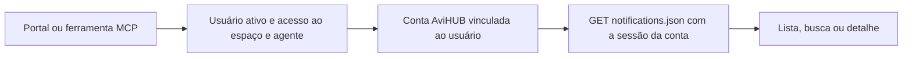

# AviHUB — Central de Notificações

Abra **Notificações do AviHUB** no agente de um espaço autorizado do Hub IA. A página lista os avisos da conta AviHUB vinculada, busca um termo na central nativa e abre o detalhe de cada item. Os filtros disponíveis são **Lidas**, **Não lidas** e **Favoritas**. A listagem preserva a ordem do AviHUB, da mais recente em diante.

A leitura usa a sessão da própria conta AviHUB vinculada ao usuário do Hub IA. Se houver mais de uma conta, escolha a que deseja consultar. O AviHUB aplica a relação `current_user.notifications.kept` também nas pesquisas. O Hub devolve título, mensagem, tipo, data, estado de leitura e indicação de favorito com os dados que o AviHUB disponibiliza. Quando o aviso referencia um relatório já gerado e possui um endereço reconhecido, o detalhe oferece um link para abrir o relatório pelo AviHUB. As operações preservam o estado de leitura e favoritos. [Central nativa](https://github.com/pesoexatobalancas/avihub_web/blob/5fde5c26f79752df3a1e413071edafa4dc57b0a3/app/controllers/notifications_controller.rb#L5) · [Escopo e sessão](https://github.com/reinaldopesoexato/hubia/blob/main/apps/portal/bridge/avihub_notifications.py).

No MCP, `listar_notificacoes_avihub` lista a central, `buscar_notificacoes_avihub` exige `busca` e `consultar_notificacao_avihub` exige `notificacao_id`. Informe `conta` se existirem várias contas ou para continuar uma pesquisa. Ao abrir um item de uma lista filtrada, preserve `pagina`, `busca` e `filtro`. A central nativa retorna 20 avisos por página. Com o ID sem página, a consulta verifica as cinco primeiras páginas da seleção. Aplique uma busca ou informe a página do item para refinar o detalhe. [Ferramentas MCP](https://github.com/reinaldopesoexato/hubia/blob/main/apps/portal/bridge/mcp.py) · [Adaptador da central](https://github.com/reinaldopesoexato/hubia/blob/main/apps/portal/bridge/avihub_notification_api.py).

[[docs/Regras de Negocio/Identidade_e_Permissoes|Identidade e permissões]] · [[docs/API_Middleware/Integracoes_e_MCP|Integrações e MCP]] · [[docs/Regras de Negocio/AviHUB_Relatorios_Peso_Aves|Relatórios de Peso Aves]].

## Validação

Consulta nativa revisada no commit `5fde5c26f79752df3a1e413071edafa4dc57b0a3`; checkout do Hub IA baseado em `9e69bbd`. O smoke usa sessões e notificações fictícias para conferir listagem, busca, detalhe e isolamento entre contas. [Teste de integração](https://github.com/reinaldopesoexato/hubia/blob/main/apps/portal/bridge/smoke_avihub_notifications.py).

Em 26/11/2026, passaram os 59 testes unitários, o `django check` e o smoke com PostgreSQL 16.16 descartável. A integração exerceu `hub.read`, a rejeição de acesso à conta de outro usuário, a paginação, o reaproveitamento dos filtros no detalhe e a proteção CSRF no portal. O teste simulou apenas o transporte HTTP para o AviHUB.

Após a publicação no Hub IA, a rota da central redirecionou visitantes sem sessão para o login. `listar_contas_avihub` devolveu o link da central em uma conexão autorizada. A verificação em produção confirmou a rota e o link, enquanto a leitura de avisos foi validada no teste com sessão simulada. O catálogo do cliente usado para a verificação ainda apresentava a revisão anterior.

Em 26/11/2026, **Refresh tools** nas configurações da instalação do HUB IA no ChatGPT publicou as três ações de notificações no catálogo do cliente. Uma conversa Work nova com o plugin selecionado retornou três avisos reais da central nativa de uma conta vinculada e apresentou os links autorizados para os relatórios. O histórico de uma conversa anterior ainda exibia a resposta baseada em e-mails. [[docs/API_Middleware/Integracoes_e_MCP|Atualização do catálogo MCP]].
