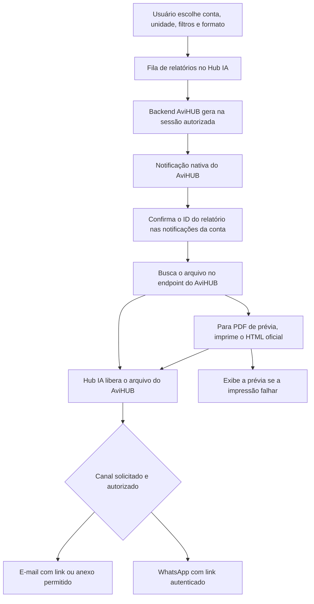

# AviHUB — Relatórios de Peso Aves

O agente AviHUB oferece **Relatórios de Peso Aves** no portal e no MCP. O usuário escolhe a conta vinculada, a unidade ativa, o período, o formato e um canal entre os disponíveis. Os filtros do formulário avançado incluem núcleo, lote, galpão, lado, box, equipamento, sexo, tipo de balança, visualização e período de pesagem com horários quando aplicável. A lista usa os seletores do próprio AviHUB, com os filtros vinculados à unidade e à hierarquia escolhida. [[docs/API_Middleware/Integracoes_e_MCP|Integrações e MCP]] · [[docs/Infra/Operacao_e_Testes|Operação e testes]].

## Formatos e entrega

| Família | Opções nativas |
| --- | --- |
| Excel | `excel_aves`, `excel_amostra_completa`, `excel_resumo_aves`, `excel_box_aves` |
| CSV | `csv_aves`, `csv_aves_v2`, `csv_aves_multiblocos`, `pesagens_periodo_csv` |
| TXT e sistemas de integração | `txt_aves`, `agrosys_csv_aves`, `avecom_aves`, `avecom_2_aves`, `avecom_3_aves`, `agromanager_txt_aves` |
| PDF | `pdf` e `pdf_summary` usam os bytes do AviHUB quando disponíveis. A prévia oficial é impressa pelo Hub IA quando o AviHUB oferece o botão de impressão. |

O download no Hub IA preserva os bytes, tipo e codificação dos arquivos fornecidos pelo AviHUB e aceita até 24 MiB. O PDF impresso da prévia usa o conteúdo e CSS de impressão do próprio relatório do AviHUB. O componente de impressão do Hub IA recebe esse HTML em uma rede isolada, sem conta de banco e sem sessão AviHUB. A cópia PDF cifrada mantém os mesmos bytes nas entregas posteriores. O estado `somente_previa` fornece `url_previa` quando a impressão não termina. [Prévia oficial e impressão](https://github.com/pesoexatobalancas/avihub_web/blob/5fde5c26f79752df3a1e413071edafa4dc57b0a3/app/views/reports/_pre_visualization.html.haml#L8) · [Impressão isolada no Hub IA](https://github.com/reinaldopesoexato/hubia/blob/main/apps/portal/bridge/avihub_pdf_renderer.py).

A central de notificações do AviHUB dá acesso ao relatório também no painel nativo. No Hub IA, a consulta e o download exigem a conta que fez a solicitação e autorização vigente no espaço. Para abrir o arquivo ou a prévia, a sessão vinculada precisa ter acesso à unidade ativa.

A entrega padrão fica no painel, com link no resultado do MCP. Com o mesmo e-mail nas contas Hub IA e AviHUB e o SMTP da plataforma habilitado, o usuário pode escolher e-mail com link protegido. Para arquivos nativos de até 4 MiB, a opção de anexo preserva os bytes e a codificação. O canal WhatsApp oferece o link protegido se houver um destino habilitado e autorizado no espaço. As conexões MCP precisam de `hub.notify` para esse envio. O status **Aviso aceito pelo canal** registra o aceite do provedor. [[docs/Regras de Negocio/Identidade_e_Permissoes|Identidade e permissões]].

## Contrato MCP

1. Use `opcoes_relatorio_peso_aves` para obter as opções autorizadas de conta, unidade, formato, filtros e entrega. Passe o formato ao consultar os canais quando o usuário quer anexar o arquivo.
2. Chame `gerar_relatorio_peso_aves` com `inicio`, `fim`, `formato` e `request_id` UUID. Informe a conta, unidade, filtros e canal conforme as escolhas do usuário. Para WhatsApp, use o ID de um destino retornado nas opções.
3. Chame `consultar_relatorio_peso_aves` com o `relatorio_id` para acompanhar a geração e a entrega. A consulta sem identificador lista os relatórios da própria conta no espaço. Quando o estado chegar a `pronto`, entregue o recurso do arquivo ou o `url_download` autenticado. O campo `fonte` identifica o download do AviHUB ou a impressão da prévia. Com MCP compatível, `resources/read` atende o recurso autenticado de até 4 MiB com os mesmos bytes.

`resumir_pesagens` e `consultar_pesagens` retornam `relatorio_peso_aves` quando a leitura de Peso Aves confirma os filtros. O campo `parametros_pdf` preserva a conta, a unidade, o período, o núcleo e o equipamento. Em `eventos_peso_aves`, use a data e os filtros confirmados no evento de pesagem ou seleção, incluindo lote e modelo quando presentes. Se a conexão estiver com o catálogo anterior à geração de relatórios, use `url_portal` para abrir o formulário autenticado com os filtros preenchidos. A leitura mantém a função de consulta. [Roteamento de relatórios no MCP](https://github.com/reinaldopesoexato/hubia/blob/main/apps/portal/bridge/mcp.py).

O backend Rails recebe o formulário de `POST /reports` com a sessão da conta vinculada, token CSRF e a unidade escolhida já ativa. O Hub IA grava o `report_id` antes de consultar `GET /notifications.json`. A notificação precisa pertencer à sessão vinculada e apontar para esse ID. O Hub IA busca o arquivo em `GET /reports/:id/download` ou `GET /reports/:id/download.pdf`, que pode apontar para a prévia. Enquanto aguarda a notificação ou o arquivo, o worker repete apenas leituras do AviHUB. A repetição do mesmo `request_id` recupera a solicitação anterior. Quando há timeout depois do envio, o estado é `incerto`. Confira a central de notificações do AviHUB antes de gerar outro. [Fila e acesso no Hub IA](https://github.com/reinaldopesoexato/hubia/blob/main/apps/portal/bridge/avihub_reports.py) · [Formulário e download nativos](https://github.com/pesoexatobalancas/avihub_web/blob/5fde5c26f79752df3a1e413071edafa4dc57b0a3/app/controllers/reports_controller.rb#L243) · [Geração do aviso nativo](https://github.com/pesoexatobalancas/avihub_web/blob/5fde5c26f79752df3a1e413071edafa4dc57b0a3/app/models/report.rb#L752).

## Validação

A revisão do código nativo usou o commit `5fde5c26f79752df3a1e413071edafa4dc57b0a3`. O checkout do Hub IA parte de `9e69bbd` e inclui a migração `0030_avihub_reports`. Os testes verificam as opções, autorização, POST nativo, reaproveitamento da solicitação, prévia de PDF, download com bytes preservados, recusa de acessos de terceiros e transportes simulados. [Testes de integração](https://github.com/reinaldopesoexato/hubia/blob/main/apps/portal/bridge/smoke_avihub_reports.py) · [Opções nativas](https://github.com/pesoexatobalancas/avihub_web/blob/5fde5c26f79752df3a1e413071edafa4dc57b0a3/app/helpers/reports_helper.rb#L40).

Em 26/11/2026, passaram 47 testes unitários e o smoke integrado em PostgreSQL 16.16 descartável. A publicação aplicou a migração `0030`, iniciou `avihub-reports` e respondeu ao acesso público à rota de relatórios com redirecionamento para login. A validação de arquivos e entregas usou um backend AviHUB simulado, SMTP simulado e WhatsApp simulado. A geração com dados reais exige escolher a conta, a unidade, o período e o formato no ambiente publicado.

A revisão de roteamento publicada em 26/11/2026 passou 47 testes unitários e o smoke integrado em PostgreSQL 16.16 descartável antes da publicação. Os testes verificaram os filtros com fixtures, incluindo consultas de incubação, o link autenticado e a ausência de nova solicitação durante a leitura. Após a publicação, uma consulta autorizada de Peso Aves no MCP retornou os filtros e o link no campo `relatorio_peso_aves`. A verificação em produção foi uma consulta de leitura.

A revisão `0031_avihub_report_confirmation`, publicada no Hub IA em 26/11/2026, passou 53 testes unitários e o smoke em PostgreSQL 16.16 descartável com transporte AviHUB simulado, filtros múltiplos, confirmação da notificação, PDF, recurso MCP e entrega. O serviço de impressão gerou um PDF A4 de uma prévia fictícia no contêiner isolado. A inspeção verificou acentos, tabela e estilos de impressão. Em produção, a migração foi aplicada e os serviços `avihub-pdf` e `avihub-reports` ficaram saudáveis. Uma consulta autorizada confirmou os filtros e o link de um evento de seleção. Essa consulta foi somente leitura e o catálogo exposto no cliente ainda não anunciava as ações de geração.
