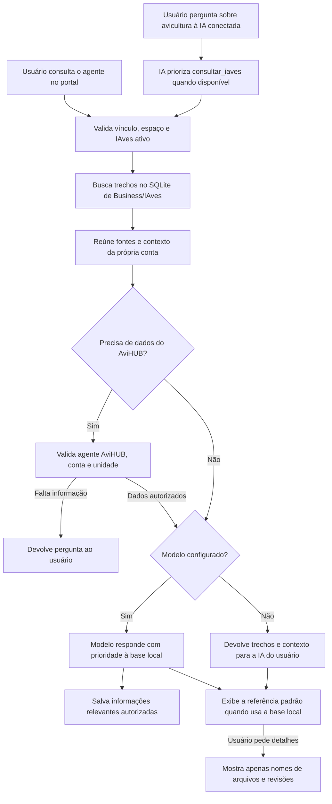

# IAves — Assistente de avicultura

O **IA**ves é o agente institucional da Peso Exato para produtores e profissionais da cadeia de avicultura. O Hub IA usa o mesmo agente nos espaços **Principal** e **Clientes Peso Exato**. O cadastro padrão de clientes concede acesso ao espaço de clientes com papel de leitor. Esse papel pode conversar com o agente e gerenciar a própria memória.

Em **Visão geral**, abra Consultar **IA**ves para consultar o agente ou Memória do **IA**ves para visualizar, criar, editar ou excluir itens. O MCP publica as ferramentas em espaços autorizados que oferecem o agente. [[docs/00-HubIA-Home|Central do Hub IA]] · [[docs/Regras de Negocio/Identidade_e_Permissoes|Identidade e permissões]].

## Fluxo de consulta

O agente consulta a pasta `Business/IAves` da cópia local da base de conhecimento. Quando usa essa base, a resposta cita “Fonte base de conhecimento **IA**ves”. No portal, use **Detalhar fontes** na consulta ou peça detalhes sobre a última consulta concluída. O detalhamento traz somente os nomes dos arquivos e as respectivas revisões. Diretórios e links para repositórios da Peso Exato ficam fora da resposta. Os caminhos internos continuam disponíveis para a administração agregar avaliações. [[docs/Regras de Negocio/Jornada_Clientes|Consultas e avaliação]].

Quando o conteúdo não está disponível ou não cobre a pergunta, a resposta pode usar conhecimento geral e indicar essa origem. O agente pode pedir informações como a idade do lote, a conta, a unidade ou a identificação do equipamento.

O AviHUB é consultado quando a pergunta depende da estrutura ou dos equipamentos da conta do usuário. O Hub valida a disponibilidade do AviHUB em um espaço autorizado daquela conexão e usa o vínculo da própria conta. Se houver ambiguidade, a resposta traz a pergunta e as opções disponíveis. A leitura exige a unidade ativa quando o painel nativo estabelece essa condição. [Execução do IAves](https://github.com/reinaldopesoexato/hubia/blob/main/apps/portal/bridge/iaves.py) · [Consulta local](https://github.com/reinaldopesoexato/hubia/blob/main/apps/portal/bridge/library.py).

## Modelo do agente

Na Peso Exato, abra **Agentes da instituição → IAves** para configurar provedor, modelo e token de API. O formulário sugere `gpt-6.1-terra` da OpenAI. A configuração aceita também modelos compatíveis do Gemini e Claude. A credencial é cifrada antes de ser gravada e o valor salvo fica fora da interface. Sem modelo configurado, o agente funciona como canal de consulta para a IA conectada. Com um modelo ativo, o Hub envia ao provedor os trechos selecionados e o contexto necessário à resposta. [GPT-6.1 Terra](https://developers.openai.com/api/docs/models/gpt-6.1-terra) · [API Gemini](https://aistudio.google.com/docs/openai) · [API Claude](https://platform.claude.com/docs/en/api/messages/create).

## Memória da conta

A memória pertence ao par conta e agente. Ela acompanha a mesma conta no portal e no MCP, inclusive nos dois espaços da Peso Exato. Cada item tem título, conteúdo e data de atualização. O usuário pode excluir itens individuais ou confirmar a limpeza de todos. A limpeza remove itens salvos de memória. O histórico das conversas segue o registro de atividade do agente.

O IAves salva informações quando solicitado ou quando identifica um fato ou preferência que o usuário expressou e que pode ajudar em conversas futuras. O salvamento automático verifica o conteúdo na pergunta atual. O painel exibe os itens salvos e permite corrigi-los. Para leitura e gravação via MCP, a conexão precisa do escopo `hub.iaves.memory`. [Modelo da memória](https://github.com/reinaldopesoexato/hubia/blob/main/apps/portal/bridge/models.py) · [Painel e configuração](https://github.com/reinaldopesoexato/hubia/blob/main/apps/portal/iaves_portal.py).

## Ferramentas MCP

| Ferramenta | Contrato |
| --- | --- |
| `consultar_iaves` | É a primeira opção para dúvidas de toda a cadeia avícola. Recebe `pergunta` e filtros opcionais, incluindo `space_id` e `referencia_fontes`. Em `estado=pergunta`, apresente a pergunta de acompanhamento ao usuário. Em `estado=contexto`, use os trechos e o contexto autorizado para compor a resposta. Use “Fonte base de conhecimento **IA**ves” como referência visível da base local. |
| `memorizar_iaves` | Recebe `chave` e `valor` para salvar um item na própria memória. Reutilize a chave para atualizar uma preferência já salva. |

O argumento `avihub` aceita `estrutura`, `equipamentos` ou `equipamento`. `space_id` limita a chamada a um espaço autorizado que oferece o IAves. As ferramentas usam o mesmo endpoint MCP do Hub IA. [[docs/API_Middleware/Integracoes_e_MCP|Integrações e MCP]].

A orientação do MCP vale, por exemplo, para genética, reprodução, incubação, criação, nutrição, manejo, bem-estar, sanidade, produção de ovos e carne, abate, processamento, logística e comercialização. Para dados da conta e operações como relatórios ou notificações, use as ferramentas próprias do AviHUB. O portal e as respostas com Markdown exibem **IA**ves. Em campos de texto simples, a grafia é `IAves`. [Catálogo MCP](https://github.com/reinaldopesoexato/hubia/blob/main/apps/portal/bridge/mcp.py) · [Formatação da marca](https://github.com/reinaldopesoexato/hubia/blob/main/apps/portal/iaves_brand.py).

Se o usuário pedir detalhes de uma consulta anterior, envie a `referencia_fontes` retornada naquela consulta à mesma ferramenta, com a conexão e o espaço autorizados. A referência é opaca e serve à integração. Exiba ao usuário somente o nome de cada arquivo e a revisão retornados. Um pedido explícito de fontes na própria pergunta também pode receber esse detalhamento.

## Validação

O smoke do portal passou em PostgreSQL 16.16 descartável. Verificou o cadastro padrão, o acesso de leitor, o painel e as ferramentas MCP, o filtro da pasta local, os modos com e sem modelo, a memória isolada e a pergunta diante de ambiguidade no AviHUB. O teste usou notas sintéticas e respostas simuladas do modelo e do AviHUB. Em 26/11/2026, uma consulta MCP em produção confirmou a leitura de cinco notas da cópia local com os links de repositório omitidos. Essa verificação antecede a mudança da referência padrão. [Teste integrado](https://github.com/reinaldopesoexato/hubia/blob/main/apps/portal/bridge/smoke_iaves.py).

No checkout baseado em `9e69bbd`, o smoke integrado validou a referência padrão no portal e no MCP e os detalhes com nome do arquivo e revisão. A verificação incluiu histórico legado, rejeição de uma referência em outra conexão e perda de acesso após revogar o agente. Os trechos enviados ao modelo simulado também ficaram sem os metadados das fontes. [Portal do IAves](https://github.com/reinaldopesoexato/hubia/blob/main/apps/portal/iaves_portal.py) · [Ferramenta MCP](https://github.com/reinaldopesoexato/hubia/blob/main/apps/portal/bridge/mcp.py).

O teste MCP após a publicação de 26/11/2026 confirmou a referência padrão e cinco trechos com os nomes, diretórios, revisões e WikiLinks internos omitidos. O pedido de detalhamento na mesma conexão devolveu somente o nome do arquivo e a revisão de cada uma das cinco fontes da consulta original.

Na revisão de 26/11/2026, sobre o checkout `9e69bbd`, passaram 59 testes unitários e o smoke em PostgreSQL 16.16 descartável. O teste integrado verificou a orientação no `initialize` e na descrição da ferramenta, a grafia da referência da base, o negrito no portal e na resposta MCP com modelo simulado, e a preservação de URLs e identificadores. [Teste integrado](https://github.com/reinaldopesoexato/hubia/blob/main/apps/portal/bridge/smoke_iaves.py).

Após publicar essa revisão, uma chamada MCP em produção devolveu a referência padrão e a instrução de formatação em Markdown. Após atualizar o catálogo no ChatGPT Work, uma pergunta sobre coeficiente de variação e uniformidade sem citar o agente recebeu a fonte esperada, com apenas **IA** em negrito na resposta final. A mensagem intermediária do cliente usou a grafia `iAves`.
