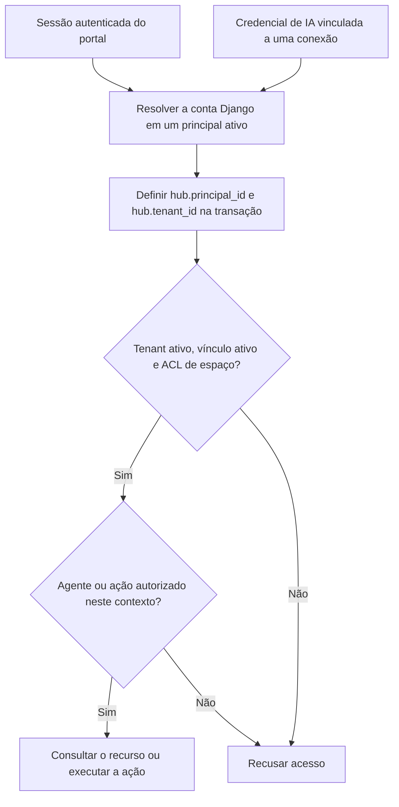

# Identidade e permissões do Hub IA

O HUB IA resolve a identidade da pessoa na transação e, para abrir um espaço, cruza o vínculo no tenant com a ACL daquele espaço. Agentes e conexões de IA acrescentam filtros próprios. Este mapa descreve a implementação no checkout e complementa a [[docs/00-HubIA-Home|central do Hub IA]].

## Da conta ao recurso

O diagrama mostra o acesso de uso. A gestão institucional usa funções administrativas específicas e segue as regras da seção de papéis. [Contexto do espaço](https://github.com/reinaldopesoexato/hubia/blob/9e69bbd733653589851c54866f2fad2c14915bd0/apps/portal/space_views.py) · [Contexto das conexões](https://github.com/reinaldopesoexato/hubia/blob/9e69bbd733653589851c54866f2fad2c14915bd0/apps/portal/bridge/access.py).

| Entidade | Responsabilidade |
| --- | --- |
| Conta Django e `AccountProfile` | Autenticação no portal e dados de perfil. O `google_subject` vincula um login Google à conta Django. |
| `hub_identity.users` e `hub_identity.identities` | Principal global em UUID e vínculo por `(issuer, subject)`. O portal usa `urn:hubia:portal:local` e o ID da conta Django como `subject`. |
| `hub_tenancy.tenants` | Fronteira de isolamento. Cada instituição (`ORGANIZATION`) e cada área pessoal (`PERSONAL`) tem seu próprio tenant. |
| `memberships` e `workspace_members` | O vínculo institucional ou pessoal define o papel. A ACL associa a pessoa a um workspace por `tenant_id`, `workspace_id` e `user_id`. |
| `agents`, `agent_spaces` e `workspace_agents` | Um agente pessoal pertence ao espaço. Um agente institucional pertence ao catálogo do tenant e aparece nos espaços selecionados por meio de `agent_spaces`. A view usa `security_invoker`. |
| `user_agent_blocks` e `agent_runs` | Um bloqueio individual restringe leitura de agentes, inclusive a consulta usada por gestores. O histórico de execução é privado por principal e espaço. |

O cadastro por senha cria uma solicitação de ativação por e-mail. O cadastro efetivo cria a conta e o tenant pessoal após confirmar o link e a senha informada. O Google Sign-In depende de configuração e valida o token do provedor. Se o e-mail já pertencer a uma conta com senha, o vínculo exige autenticação nessa conta. Quando o espaço de admissão da instituição está configurado e ativo, o gatilho de criação do tenant pessoal concede `viewer` naquele espaço. [Cadastro e Google Sign-In](https://github.com/reinaldopesoexato/hubia/blob/9e69bbd733653589851c54866f2fad2c14915bd0/apps/portal/registration.py) · [Admissão de clientes](https://github.com/reinaldopesoexato/hubia/blob/9e69bbd733653589851c54866f2fad2c14915bd0/packages/database/migrations/012-client-workspace.sql).

## Papéis e limites de gestão

| Papel | Escopo |
| --- | --- |
| Administrador geral (`platform_owner`) | Administra contas, instituições e espaços institucionais. As funções administrativas permitem gerir espaços institucionais mesmo sem vínculo na ACL. A abertura como usuário continua sujeita às políticas de acesso do espaço. |
| Responsável (`institution_owner`) | Gerencia o catálogo institucional, os espaços aos quais pertence e os papéis dos membros. O provisionamento o inclui no espaço principal e a criação de espaços da instituição preserva seu acesso. |
| Administrador institucional (`institution_admin`) | Gerencia o catálogo da instituição e os espaços aos quais pertence. A alteração de papéis institucionais cabe ao responsável ou ao administrador geral. |
| Membro (`member`) | Acessa os espaços concedidos e as operações disponíveis para o agente, canal ou conexão. |
| Leitor (`viewer`) | Consulta os recursos disponíveis em seus espaços. A execução de agentes pelo fluxo genérico e os envios sujeitos à permissão de escrita são bloqueados. |
| Titular (`personal_owner`) | Gerencia o próprio espaço pessoal, seus agentes e a configuração de modelo desse espaço. |

Ao gerenciar um membro pelo espaço, conceder ou revogar espaço altera `workspace_members`. Mudar o papel atualiza `memberships`, com efeito no tenant inteiro. O painel de pessoas do administrador geral também pode alterar o vínculo institucional, a ACL e os bloqueios individuais. A remoção institucional nesse painel remove os vínculos aos espaços antes do vínculo ao tenant. Alterações administrativas de vínculo e papel são auditadas. [Gestão de membros](https://github.com/reinaldopesoexato/hubia/blob/9e69bbd733653589851c54866f2fad2c14915bd0/packages/database/migrations/006-space-members.sql) · [Acesso por conta](https://github.com/reinaldopesoexato/hubia/blob/9e69bbd733653589851c54866f2fad2c14915bd0/packages/database/migrations/011-user-access.sql).

A suspensão torna o tenant invisível nas consultas de uso. A lixeira preenche `deleted_at`, filtrado pela RLS e pela função de gestão. Restaurar limpa esse campo e reaplica os vínculos existentes sujeitos às regras atuais. O espaço principal fica fora da operação de lixeira. [Políticas de isolamento](https://github.com/reinaldopesoexato/hubia/blob/9e69bbd733653589851c54866f2fad2c14915bd0/packages/database/migrations/001-tenancy.sql) · [Lixeira e gestão](https://github.com/reinaldopesoexato/hubia/blob/9e69bbd733653589851c54866f2fad2c14915bd0/packages/database/migrations/008-workspace-trash.sql) · [Catálogo institucional](https://github.com/reinaldopesoexato/hubia/blob/9e69bbd733653589851c54866f2fad2c14915bd0/packages/database/migrations/009-institution-agents.sql).

## Agentes, conexões e permissões adicionais

- Para uso no portal, resolva o agente ativo com a combinação `(tenant, space, agent)` pela view `workspace_agents`. Preserve a atribuição institucional por espaço e o filtro de bloqueio por pessoa. [Uso de agentes](https://github.com/reinaldopesoexato/hubia/blob/9e69bbd733653589851c54866f2fad2c14915bd0/apps/portal/space_views.py) · [Catálogo institucional](https://github.com/reinaldopesoexato/hubia/blob/9e69bbd733653589851c54866f2fad2c14915bd0/packages/database/migrations/009-institution-agents.sql).
- `Link` associa usuário, tenant, espaço de origem e protocolo. No MCP unificado, `WorkspaceSelection` cruza a seleção da conexão com os espaços que o usuário ainda pode acessar em seus tenants. Nas conexões antigas, a seleção continua limitada ao tenant de origem. `None` (ou seleção ausente) inclui todos os espaços atualmente visíveis no escopo, a lista restringe os espaços e `[]` pausa a conexão. Escopos OAuth e concessões dos conectores continuam aplicáveis. Veja [[docs/API_Middleware/Integracoes_e_MCP|integrações e MCP]]. [Seleção de espaços](https://github.com/reinaldopesoexato/hubia/blob/main/apps/portal/bridge/workspaces.py).
- O e-mail interno requer `internal_mail` no vínculo ativo da instituição Peso Exato. No MCP, a caixa e as permissões de leitura e envio são verificadas por conexão. As concessões de caixa são armazenadas separadamente das ACLs de espaço. [E-mail interno](https://github.com/reinaldopesoexato/hubia/blob/9e69bbd733653589851c54866f2fad2c14915bd0/apps/portal/bridge/mail_access.py) · [Migração da permissão](https://github.com/reinaldopesoexato/hubia/blob/9e69bbd733653589851c54866f2fad2c14915bd0/packages/database/migrations/013-internal-mail.sql).

## Pontos de revisão ao alterar acessos

- Resolva o principal da conta autenticada com `bind_account` e defina `hub.principal_id` e `hub.tenant_id` via `set_config(..., true)` com parâmetros vinculados. Mantenha o contexto e as consultas na mesma transação. O `true` limita o valor à transação. A conta de banco `hub_portal` herda `hub_runtime` e é criada com `NOBYPASSRLS`. [Identidade do portal](https://github.com/reinaldopesoexato/hubia/blob/9e69bbd733653589851c54866f2fad2c14915bd0/apps/portal/portal_identity.py) · [Papel do portal](https://github.com/reinaldopesoexato/hubia/blob/9e69bbd733653589851c54866f2fad2c14915bd0/packages/database/migrations/002-portal.sql).
- Use as funções `hub_admin` existentes para as operações administrativas e preserve a separação entre leitura com RLS e gestão com `SECURITY DEFINER`. Nas tabelas Django do bridge, mantenha os filtros explícitos de usuário, tenant, espaço ou conexão que cada recurso exige. Restrinja a credencial de banco e a execução de SQL ao backend. [[docs/security/tenancy|Fronteira de confiança no banco]] · [[docs/adr/0001-identidade-e-tenancy|Decisão original de identidade e tenancy]].
- Para confirmar o isolamento, use a suíte SQL para testar contexto ausente, ACL, troca de tenant, suspensão e identidade desativada. Os smokes do portal cobrem cadastro, catálogo e execução de agentes, lixeira e seleção de conexões. Siga o ambiente descrito em [[docs/Infra/Operacao_e_Testes|operação e testes]]. [Teste SQL](https://github.com/reinaldopesoexato/hubia/blob/9e69bbd733653589851c54866f2fad2c14915bd0/tests/integration/tenancy.psql) · [Smoke de cadastro](https://github.com/reinaldopesoexato/hubia/blob/9e69bbd733653589851c54866f2fad2c14915bd0/apps/portal/smoke_registration.py) · [Smoke de espaços](https://github.com/reinaldopesoexato/hubia/blob/9e69bbd733653589851c54866f2fad2c14915bd0/apps/portal/smoke_spaces.py) · [Smoke de agentes](https://github.com/reinaldopesoexato/hubia/blob/9e69bbd733653589851c54866f2fad2c14915bd0/apps/portal/smoke_agents.py) · [Smoke de seleção MCP](https://github.com/reinaldopesoexato/hubia/blob/9e69bbd733653589851c54866f2fad2c14915bd0/apps/portal/bridge/smoke_workspaces.py).
