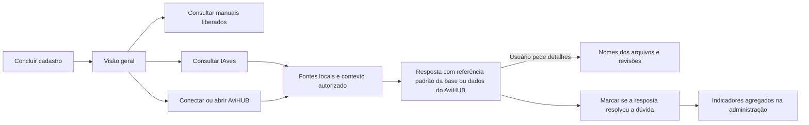

# Jornada dos clientes no Hub IA

Novos clientes recebem o espaço **Clientes Peso Exato** no cadastro. A página **Visão geral** concentra as ações de conversar com o IAves, consultar os manuais e abrir o AviHUB, conforme os agentes e serviços liberados. Quando o AviHUB exige vínculo, o painel aponta para a conta a conectar ou confirmar. [[docs/Regras de Negocio/IAves|IAves]] · [[docs/Regras de Negocio/Identidade_e_Permissoes|Identidade e permissões]].

## Consultas e avaliação

Quando usa a biblioteca, o **IA**ves apresenta “Fonte base de conhecimento **IA**ves”. **Detalhar fontes** mostra apenas os nomes dos arquivos e as revisões. Quando usa o AviHUB, o agente apresenta a unidade e o período disponíveis. O fluxo do portal registra a avaliação **Resolveu sua dúvida?** para consultas próprias concluídas. O usuário pode atualizar a resposta. O painel da administração agrega os caminhos internos dos documentos associados a avaliações negativas. As perguntas e as memórias continuam restritas à conta do usuário. [Portal do IAves](https://github.com/reinaldopesoexato/hubia/blob/main/apps/portal/iaves_portal.py).

## Resumos e alertas

Na página do IAves, o usuário configura o resumo do lote ou o aviso de equipamentos sem comunicação. A assinatura guarda a conta vinculada, a unidade, a frequência diária ou semanal e o canal. O resumo usa os registros autorizados de pesagem no período encerrado e identifica o núcleo e o lote. Quando o AviHUB informa pesos comparáveis, o resumo também apresenta a média e quantos registros entraram no cálculo. O aviso verifica os equipamentos que passaram 24 horas sem comunicação e evita repetir o mesmo aviso enquanto a condição permanece.

O painel é o canal padrão. A opção de e-mail depende do endereço da conta e do SMTP da plataforma. O serviço `iaves-alerts` verifica o vínculo e o acesso antes da consulta. Ele usa a unidade ativa no AviHUB e preserva a seleção do usuário no sistema externo. [Assinaturas e processamento](https://github.com/reinaldopesoexato/hubia/blob/main/apps/portal/bridge/iaves_subscriptions.py) · [[docs/Infra/Operacao_e_Testes|Operação e testes]].

## Adoção no painel administrativo

O administrador geral abre **Administração → Primeira consulta útil no IAves** e escolhe uma janela de 7 ou 30 dias. O indicador usa contas ativas admitidas pelo cadastro padrão de clientes no período. Para cada conta, usa a data da primeira consulta marcada como útil no portal. A mediana mede o intervalo entre o cadastro e essa consulta. O percentual divide o número de clientes com resposta útil pelo total de cadastros ativos da janela. [Cálculo da adoção](https://github.com/reinaldopesoexato/hubia/blob/main/apps/portal/bridge/iaves_metrics.py).

## Verificação no ambiente publicado

Confirme o login com uma conta de teste admitida em **Clientes Peso Exato**, a abertura do manual e do IAves, o vínculo permitido com o AviHUB, a edição da memória e a avaliação de uma consulta. Em seguida, use **Espaços das minhas IAs** para conferir as ferramentas que a conexão recebeu e sua última consulta de catálogo. Uma consulta ao AviHUB exige uma conta de teste vinculada com a unidade selecionada. [[docs/API_Middleware/Integracoes_e_MCP|Conexões MCP]].
