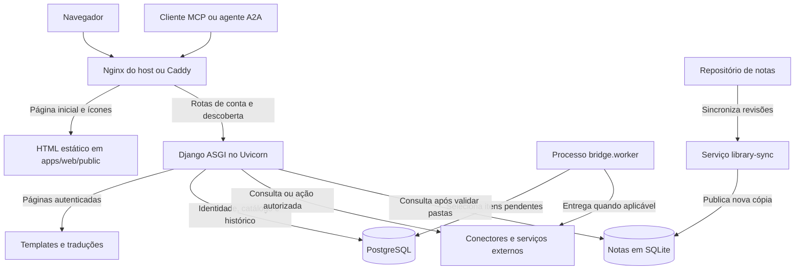
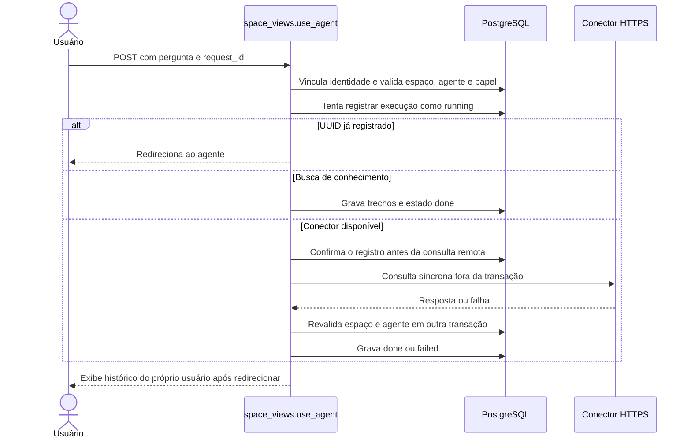

# Arquitetura do portal e execução dos agentes

Retorno à [[docs/00-HubIA-Home|central do Hub IA]]. Consulte [[docs/Regras de Negocio/Identidade_e_Permissoes|identidade e permissões]] para a composição do acesso e [[docs/API_Middleware/Integracoes_e_MCP|integrações e MCP]] para os contratos externos.

## Componentes

| Local | Responsabilidade |
| --- | --- |
| `apps/web/public/` | Página pública, distribuição estática e ícones. |
| `apps/portal/settings.py`, `asgi.py`, `views.py` | Configuração Django 5.2, middleware, ASGI e rotas. A imagem usa Python 3.13. |
| `dashboard.py`, `space_views.py`, `institution_agents.py` | Visão geral, guia, catálogo dos espaços, gestão institucional e execução no navegador. |
| `agent_runtime.py`, `model_provider.py` | Busca textual, chamadas HTTPS e credencial cifrada do modelo de cada espaço. |
| `apps/portal/bridge/` | OAuth, MCP, A2A, conectores, notificações, worker de eventos e sincronização da biblioteca. |
| `packages/database/` e `apps/portal/bridge/migrations/` | SQL de identidade, tenancy e RLS, mais migrações Django dos dados da aplicação. |

Referências da topologia e do portal. [Compose de produção](https://github.com/reinaldopesoexato/hubia/blob/9e69bbd733653589851c54866f2fad2c14915bd0/deploy/compose.production.yaml) · [Imagem do portal](https://github.com/reinaldopesoexato/hubia/blob/9e69bbd733653589851c54866f2fad2c14915bd0/apps/portal/Dockerfile) · [Configuração Django](https://github.com/reinaldopesoexato/hubia/blob/9e69bbd733653589851c54866f2fad2c14915bd0/apps/portal/settings.py) · [Worker](https://github.com/reinaldopesoexato/hubia/blob/9e69bbd733653589851c54866f2fad2c14915bd0/apps/portal/bridge/worker.py).

## Navegação e catálogo

- `/conta/` reúne espaços, agentes, consultas por conexão e atividade do usuário. O período da visão geral é de 7 ou 30 dias. `/conta/espacos/` lista os espaços da conta. `/conta/guia/` exibe o guia pessoal quando habilitado. [Rotas e views](https://github.com/reinaldopesoexato/hubia/blob/9e69bbd733653589851c54866f2fad2c14915bd0/apps/portal/views.py) · [Agregação da visão geral](https://github.com/reinaldopesoexato/hubia/blob/9e69bbd733653589851c54866f2fad2c14915bd0/apps/portal/dashboard.py).
- `/conta/espacos/<tenant>/<space>/` usa a visão `hub_tenancy.workspace_agents` para montar o catálogo. Agentes pessoais são cadastrados no espaço. Agentes institucionais pertencem à instituição e ficam disponíveis por associação em `agent_spaces`. Desativar mantém a associação. Retirar um agente institucional do catálogo marca `retired`, remove as associações e cancela avisos pendentes. Restaurar mantém o ID e permite disponibilizá-lo novamente aos espaços. [Views do espaço](https://github.com/reinaldopesoexato/hubia/blob/9e69bbd733653589851c54866f2fad2c14915bd0/apps/portal/space_views.py) · [Gestão institucional](https://github.com/reinaldopesoexato/hubia/blob/9e69bbd733653589851c54866f2fad2c14915bd0/apps/portal/institution_agents.py) · [Migração do catálogo](https://github.com/reinaldopesoexato/hubia/blob/9e69bbd733653589851c54866f2fad2c14915bd0/packages/database/migrations/009-institution-agents.sql).
- `/conta/idioma/` guarda o idioma escolhido no cookie e, para usuários autenticados, no perfil. `/conta/perfil/` gerencia a foto. A interface prioriza o upload próprio, depois a foto Google disponível e então o Gravatar quando há e-mail. [Idioma](https://github.com/reinaldopesoexato/hubia/blob/9e69bbd733653589851c54866f2fad2c14915bd0/apps/portal/languages.py) · [Foto de perfil](https://github.com/reinaldopesoexato/hubia/blob/9e69bbd733653589851c54866f2fad2c14915bd0/apps/portal/profile_photos.py).

## Comportamento por tipo de agente

| Tipo | Execução no portal |
| --- | --- |
| `knowledge` | Compara termos da pergunta com os parágrafos da configuração e retorna até três trechos correspondentes. |
| `external` | Mostra o link HTTPS. A autenticação acontece no destino. |
| `connector` | Resolve a referência do conector pelo tenant e pelo espaço. Executa consulta HTTP JSON ou chama um provedor Chat Completions. |
| `notifications` | Mostra canais e destinos ativos. O envio passa pelo fluxo de mensagens com autorização e histórico próprios. |
| `library` | Busca e lê as notas Markdown no volume local. O serviço `library-sync` atualiza a cópia e o portal valida as pastas liberadas a cada consulta. |
| `avihub` | Usa o fluxo do conector AviHUB, condicionado à habilitação do agente e à conta vinculada. |

O formulário comum cria os quatro primeiros tipos. `library` e `avihub` são cadastrados pelos fluxos de integração. O guia da conta é controlado pelo perfil e acessado pela rota própria. [Formulário e despachos do portal](https://github.com/reinaldopesoexato/hubia/blob/9e69bbd733653589851c54866f2fad2c14915bd0/apps/portal/space_views.py) · [Executores de conhecimento e HTTP](https://github.com/reinaldopesoexato/hubia/blob/9e69bbd733653589851c54866f2fad2c14915bd0/apps/portal/agent_runtime.py) · [Catálogo de conectores](https://github.com/reinaldopesoexato/hubia/blob/9e69bbd733653589851c54866f2fad2c14915bd0/apps/portal/bridge/agent_catalog.py).

## Execução de conhecimento ou conector no navegador

A pergunta aceita até 2.000 caracteres. Um conflito de UUID evita uma segunda execução. Uma falha ao encontrar ou carregar o conector pode ser registrada antes da chamada HTTP. O histórico geral do agente traz até 50 registros próprios, filtrados por tenant, espaço e agente. Uma execução `running` com mais de dois minutos aparece como interrompida na página do agente. As filas do worker atendem aos fluxos de eventos e e-mails previstos no código. [View e histórico](https://github.com/reinaldopesoexato/hubia/blob/9e69bbd733653589851c54866f2fad2c14915bd0/apps/portal/space_views.py) · [Worker](https://github.com/reinaldopesoexato/hubia/blob/9e69bbd733653589851c54866f2fad2c14915bd0/apps/portal/bridge/worker.py).

### Configuração de modelo e conectores

O registro de API REST usa `/run/hubia/connectors.json`, indexado por tenant, espaço e identificador do conector. Na interface, a configuração OpenAI por espaço usa a referência `modelo-do-espaco`. A chave é cifrada com material derivado do segredo Django e o formulário exibe apenas modelo e instruções. Em um espaço pessoal, a interface permite cadastrar o agente **Assistente de IA** junto com a configuração. Na instituição, o catálogo é gerenciado em separado. [Registro e contrato HTTP](https://github.com/reinaldopesoexato/hubia/blob/9e69bbd733653589851c54866f2fad2c14915bd0/apps/portal/agent_runtime.py) · [Persistência da configuração](https://github.com/reinaldopesoexato/hubia/blob/9e69bbd733653589851c54866f2fad2c14915bd0/apps/portal/model_provider.py) · [Gestão do modelo](https://github.com/reinaldopesoexato/hubia/blob/9e69bbd733653589851c54866f2fad2c14915bd0/apps/portal/space_views.py).

Para Chat Completions, a view carrega até quatro pares anteriores concluídos do mesmo usuário, agente, espaço e configuração de conversa. Para o conector JSON genérico, envia `query`, `request_id`, `tenant_id`, `workspace_id`, `principal_id` e `agent_id` e espera `answer` textual. O cliente usa HTTPS, tempo limite de rede de oito segundos, leitura limitada do corpo de resposta e política sem redirecionamento. [Chamada e histórico contextual](https://github.com/reinaldopesoexato/hubia/blob/9e69bbd733653589851c54866f2fad2c14915bd0/apps/portal/space_views.py) · [Contratos HTTP](https://github.com/reinaldopesoexato/hubia/blob/9e69bbd733653589851c54866f2fad2c14915bd0/apps/portal/agent_runtime.py).
